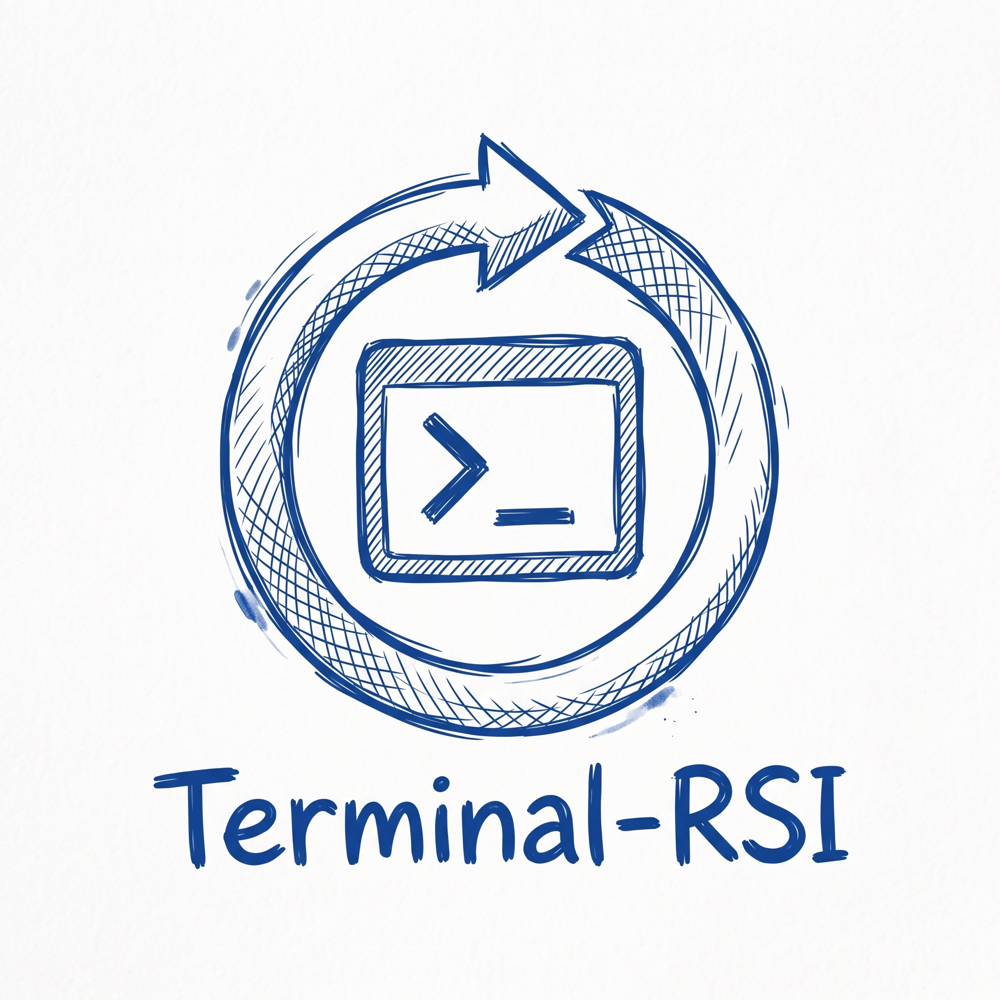
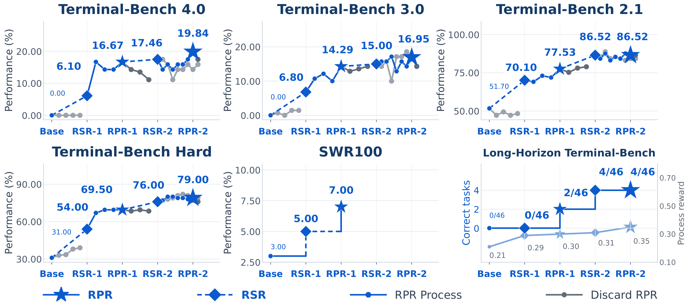
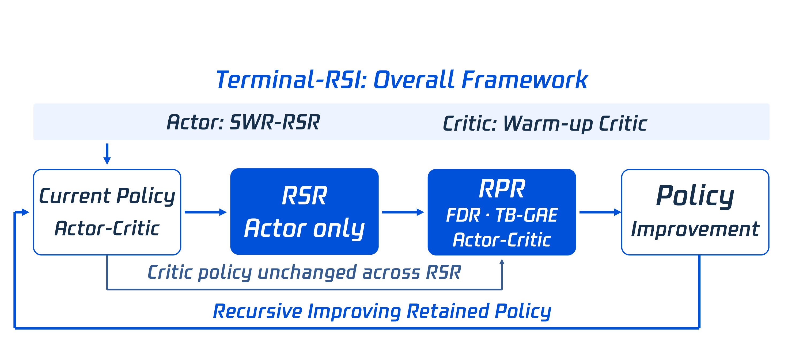
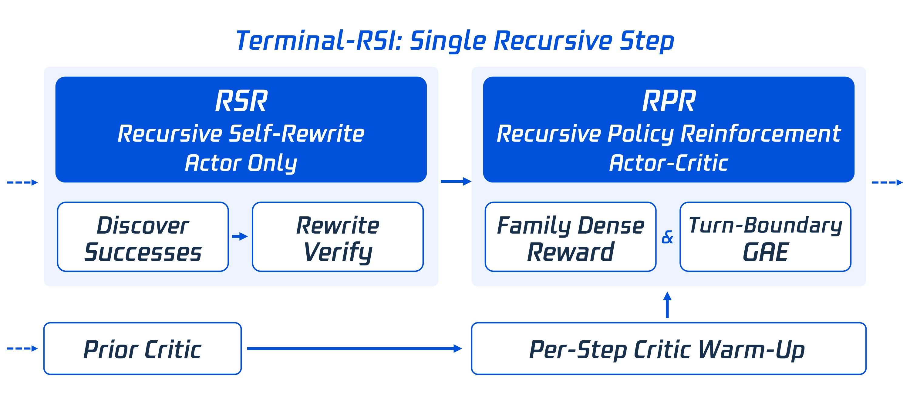
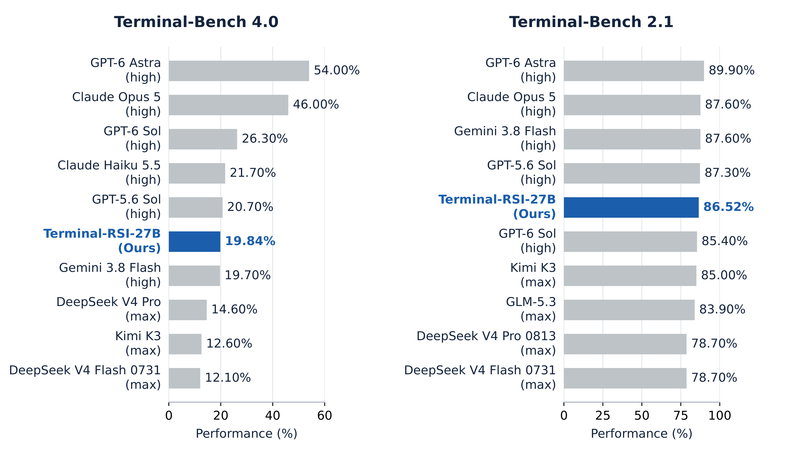

<div align="center">



# Terminal-RSI

### Recursive Self-Improving Terminal Agents via Recursive Self-Rewrite and Policy-Refine

[-b31b1b.svg)](#citation)
[](https://jyyang26.github.io/terminal-rsi)
[](https://huggingface.co/Teriminal-RSI)
[](https://www.python.org/)
[](https://pytorch.org/)
[](LICENSE)

**Junyao Yang**<sup>1,2,\*</sup>, **Zongxia Li**<sup>1,5,\*</sup>, **Yucheng Shi**<sup>1,\*</sup>, **Zhongzhi Li**<sup>1,4</sup>, **Ruhan Wang**<sup>1,5</sup>, **Ruiwen Zhou**<sup>2</sup>, **Haitao Mi**<sup>1</sup>, **Shuicheng Yan**<sup>2,†</sup>, **Leowei Liang**<sup>1</sup>

<sup>1</sup>Tencent Hy Foundation Model Frontier &nbsp; <sup>2</sup>National University of Singapore &nbsp; <sup>3</sup>University of Maryland, College Park &nbsp; <sup>4</sup>University of Georgia &nbsp; <sup>5</sup>Indiana University

<sup>\*</sup>Equal contribution &nbsp; <sup>†</sup>Corresponding author

</div>

---

## 📰 News

- **[2026-10]** Code release: RPR training recipes (FDR / SPR rewards, warm-critic handoff, TB-GAE) for Qwen3.8-27B.

## 📖 Overview

Terminal agency is judged by persistent changes to an executable environment rather than by the plausibility of a response. Hundreds of tokens may express one action, thousands of observation tokens may encode no decision, and decisive feedback often arrives many turns later. Effective learning must therefore address both the **scarcity of reproducible successes** and the **alignment of optimization signals with terminal outcomes**.

**Terminal-RSI** alternates the adopted **Recursive Self-Rewrite (RSR)**, which turns harness-assisted successes into verified public demonstrations, with our proposed **Recursive Policy-Refine (RPR)**, a reinforcement-learning phase that couples a recursively handed-off critic with turn-aware credit assignment and phase-adaptive rewards:

- **Turn-Boundary Skip-Observation GAE (TB-GAE)** keeps token-specific value baselines but applies discount and trace decay only across interaction turns, so observation length no longer attenuates credit. Successor values *and* advantages are carried across computational chunks, so splitting a trajectory introduces no truncation error.
- **Family Dense Reward (FDR)** normalizes semantic-check progress by a per-family divisor, removing the up-to-795× reward-scale spread between task families.
- **Success-Prioritized Reward (SPR)** adds a strict-success offset and a saturating progress term, so an incomplete trajectory can never outrank a successful one by accumulating partial checks.
- **Recursive critic handoff.** The critic is carried unchanged through actor-only RSR stages and briefly recalibrated (four critic-only updates) at the start of every RPR phase.

Starting from Qwen3.8-27B, the sequence **Base → RSR-1 → RPR-1 → RSR-2 → RPR-2** yields **Terminal-RSI-27B** (RPR-2, step 18), which reaches **86.52%** on Terminal-Bench 2.1, **16.95%** on Terminal-Bench 3.0, **19.84%** on Terminal-Bench 4.0 and **79.00%** on Terminal-Bench Hard. Its **50.58%** four-suite macro-average is up from 20.68% at Base and 34.25% at RSR-1. Separately, rescoring 4,352 fixed trajectories with SPR reduces the failed trajectories' share of reward mass from **50.09%** to **28.72%**.

<div align="center">

<p><b>Figure 1. Retained-stage gains coexist with nonmonotonic exploration.</b> Positions denote Base, RSR-1, RPR-1 (step 20), RSR-2 and RPR-2 (step 18, Terminal-RSI-27B). These are stage positions, not equal compute intervals. Blue diamonds mark RSR, stars the retained RPR checkpoints, and gray branches unretained controls or continuations. LHTB shows completed tasks (left axis) and process reward (right axis).</p>
</div>

## 🧠 Method

### Overall framework

<div align="center">

<p><b>Figure 2. Recursive policy improvement preserves value knowledge across supervised transitions.</b> Actor-only RSR alternates with joint actor–critic RPR; the bypass carries critic weights through RSR, and the feedback arrow returns the retained policy to the next cycle.</p>
</div>

If $(\theta_k^+,\phi_k^+)$ are the actor and critic retained after RPR phase $k$, the next cycle is

$$
(\theta_{k+1}^{0},\phi_{k+1}^{0})=\big(\mathrm{RSR}(\theta_k^+,Q_k^{\rm clean}),\ \phi_k^+\big),\qquad
\phi_{k+1}^{\rm warm}=\mathrm{Warmup}_4\big(\phi_{k+1}^{0};\ \theta_{k+1}^{0}\ \text{fixed}\big),
$$

i.e. the critic is untouched by RSR ($\Delta\phi|_{\rm RSR}=0$) and recalibrated with four critic-only updates before joint PPO training resumes. Before the first RPR phase, one critic-only epoch on the SWR task pool prepares the **Warm-up Critic** $\phi_{\rm seed}$ while the actor stays frozen.

### A single recursive step

<div align="center">

<p><b>Figure 3. Supervised rewriting and policy refinement require different parameter updates.</b> The left branch (RSR, actor only) discovers, rewrites and verifies demonstrations. The right branch (RPR, actor–critic) connects the prior critic, the per-phase critic warm-up, reward calibration and turn-boundary credit assignment.</p>
</div>

**RSR (adopted).** Following RSR, successful trajectories discovered under complementary harnesses are converted into runbooks, gated for schema validity and leakage, re-executed under the target harness, and kept only if the protected verifier passes. The accepted public trajectories $Q_k^{\rm clean}$ supervise the actor with masked negative log-likelihood, while the critic stays fixed.

**RPR (proposed).** RPR updates actor and critic jointly with PPO (asymmetric clip $\epsilon_\ell=0.3,\ \epsilon_h=5$, value clip 4, no KL or entropy terms). Its two distinctive components are:

<table>
<tr><th>Rewards (Sec. 2.2)</th><th>TB-GAE (Sec. 2.3)</th></tr>
<tr><td>

$$R_{\rm FDR}=C\,\frac{P}{D_f}+(1-C)\,S$$

$$R_{\rm SPR}=S+C\,\frac{P}{P+D'_f}$$

$P$ = passed semantic checks, $S$ = strict success, $C$ = valid CTRF report, $D_f$ = family divisor (historical p90, fallback 82). Under SPR every failure scores $<1$ and every success $\ge 1$.

</td><td>

$$(\Gamma_j,\Lambda_j)=\begin{cases}(1,1) & t(j{+}1)=t(j)\\(\gamma_{\rm turn},\lambda_{\rm turn}) & \text{otherwise}\end{cases}$$

$$\delta_j=\tilde r_j+\Gamma_j(1-d_j)v_{j+1}-v_j$$

$$A_j=\delta_j+\Gamma_j\Lambda_j(1-d_j)A_{j+1}$$

$K$ turn boundaries give attenuation $(\gamma_{\rm turn}\lambda_{\rm turn})^K$, independent of observation length.

</td></tr>
</table>

## 📊 Results

Success rates (%) of the same checkpoint across all four suites at each retained stage; arrows are gains over the preceding retained stage.

| Checkpoint | Terminal-Bench 4.0 | Terminal-Bench 2.1 | Terminal-Bench 3.0 | Terminal-Bench Hard | Macro-avg. |
| --- | :---: | :---: | :---: | :---: | :---: |
| Base (Qwen3.8-27B) | 0.00 | 51.70 | 0.00 | 31.00 | 20.68 |
| Direct PPO (control) | 0.00 | 48.31 | 1.43 | 39.00 | 22.19 |
| RSR-1 | 6.10 <sub>↑6.10</sub> | 70.10 <sub>↑18.40</sub> | 6.80 <sub>↑6.80</sub> | 54.00 <sub>↑23.00</sub> | 34.25 |
| RPR-1 (step 20) | 16.67 <sub>↑10.57</sub> | 77.53 <sub>↑7.43</sub> | 14.29 <sub>↑7.49</sub> | 69.50 <sub>↑15.50</sub> | 44.50 |
| RSR-2 | 17.46 <sub>↑0.79</sub> | **86.52** <sub>↑8.99</sub> | 15.00 <sub>↑0.71</sub> | 76.00 <sub>↑6.50</sub> | 48.75 |
| **Terminal-RSI-27B** (RPR-2, step 18) | **19.84** <sub>↑2.38</sub> | **86.52** <sub>=0.00</sub> | **16.95** <sub>↑1.95</sub> | **79.00** <sub>↑3.00</sub> | **50.58** |

<div align="center">

<p><b>External references.</b> External scores reproduce an author-provided reference table, not a re-evaluation under a unified protocol; differences can also reflect harnesses, task coverage and budgets.</p>
</div>

> [!NOTE]
> As discussed in the paper, retained-checkpoint gains are not a compute-matched estimate of the benefit of alternation. The first RPR phase used standard GAE ($\gamma=\lambda=1$), and SPR is evaluated through offline rescoring, so these gains do not isolate the causal effect of TB-GAE or SPR.

## 🗂️ Repository Structure

Terminal-RSI is built on [slime](https://github.com/THUDM/slime) (Megatron training + SGLang rollout over Ray). The agentic RL integration is a plugin layer, so slime core stays close to upstream.

```text
Terminal-RSI/
├── train_async.py                 # RL entry point: rollout of step t+1 overlaps training on step t
├── train.py                       # synchronous / eval-only entry point
├── examples/
│   ├── terminal_rsi/              # ★ Terminal-RSI recipes (start here)
│   │   ├── run_rpr1_fdr.sh        #   RPR-1: Family Dense Reward, actor lr 5e-7
│   │   ├── run_rpr2_spr.sh        #   RPR-2: Success-Prioritized Reward, actor lr 1e-7
│   │   ├── run_eval.sh            #   rollout-only evaluation on a Harbor task pool
│   │   ├── prepare_load_root.sh   #   actor / critic load-root pair for warm handoff
│   │   ├── common.sh              #   shared argument builder + Ray job submission
│   │   └── configs/               #   Harbor configs (FDR / SPR divisor tables), per-role optimizer configs
│   └── harbor_terminal_rl/        # development recipes, ablations and operational notes
├── slime_plugins/
│   ├── harbor/                    # ★ Terminal-agent RL plugin
│   │   ├── rollout.py             #   Harbor/Terminus-2 agentic rollout (generate_rollout)
│   │   ├── data_source.py         #   task-pool data source with per-epoch shuffling
│   │   ├── partial_reward.py      #   FDR (test_count_progress_rewards) and SPR (success_smoothed_progress_rewards)
│   │   ├── tb_gae*.py             #   TB-GAE: turn-boundary advantages, chunk boundaries, termination
│   │   ├── atif_adapter.py        #   Harbor trial → token-exact training samples
│   │   ├── sample_postprocess.py  #   256k token caps and response trimming
│   │   ├── train_loss.py          #   PPO policy loss used by RPR
│   │   └── agent.py, llm.py, ...  #   Terminus-2 agent bound to the SGLang policy server
│   └── models/                    # Qwen3.5/3.8 (GatedDeltaNet hybrid) Megatron specs
├── slime/                         # training framework (Megatron backend, SGLang rollout, Ray orchestration)
│   ├── backends/megatron_utils/   #   actor/critic training, TB-GAE bootstrap values
│   ├── ray/                       #   placement groups, actor/critic groups, warm-critic loading
│   └── utils/                     #   arguments (incl. TB-GAE flags), PPO utilities
├── tools/                         # checkpoint conversion (torch_dist ↔ HF), reward analysis scripts
├── tests/                         # CPU unit tests (rewards, TB-GAE math, Harbor adapters) + GPU E2E tests
├── docker/  build_conda.sh        # environment
├── docs/                          # slime documentation and development notes
└── assets/                        # logo and paper figures
```

## ⚙️ Installation

Terminal-RSI needs a CUDA build of SGLang and Megatron-LM. The most reliable path is the slime Docker image; a conda recipe pinning the same commits is also provided.

**Option A: Docker (recommended).**

```bash
docker pull slimerl/slime:latest           # see docker/ for the pinned tag and patches
docker run --gpus all --ipc=host --shm-size=64g -it slimerl/slime:latest bash
git clone https://github.com/jyyang26/Terminal-RSI.git && cd Terminal-RSI
pip install -e . --no-deps
```

**Option B: Conda / micromamba.**

```bash
git clone https://github.com/jyyang26/Terminal-RSI.git && cd Terminal-RSI
bash build_conda.sh                        # env "slime": Python 3.12, CUDA 12.9, PyTorch, pinned SGLang + Megatron-LM
micromamba activate slime
pip install -e . --no-deps
```

**Agent runtime.** Install [Harbor](https://github.com/harbor-framework/harbor) (the Terminal-Bench harness) and the context-parallel kernels for the GatedDeltaNet layers:

```bash
git clone https://github.com/harbor-framework/harbor.git /opt/harbor
export HARBOR_SRC=/opt/harbor/src                         # put on PYTHONPATH by the launchers
INSTALL_DAYTONA=1 bash examples/harbor_terminal_rl/install_harbor_runtime_deps.sh
pip install "fla-core>=0.4.2" "flash-linear-attention>=0.4.2"   # fla.ops.cp is required for CP>1
```

Rollouts execute in [Daytona](https://www.daytona.io/) sandboxes (`environment.type: daytona`), so export `DAYTONA_API_KEY`. Set `WANDB_API_KEY` for logging, or `USE_WANDB=0` to disable it.

**Sanity check (CPU only).**

```bash
python -m pytest tests/test_terminal_rsi_rewards.py tests/test_tb_gae_math.py tests/test_harbor_partial_reward.py -q
```

## 🚀 Quickstart

### 1. Prepare checkpoints and data

```bash
# HF -> Megatron torch_dist (TP1 x PP8 on one 8-GPU node; torch_dist reloads at any TP/PP/CP layout)
HF_CKPT=/path/to/Qwen3.8-27B SAVE_DIR=/path/to/Qwen3.8-27B_torch_dist \
    bash examples/harbor_terminal_rl/convert_q38_27b_base_torch_dist.sh

export HF_CKPT=/path/to/Qwen3.8-27B
export TASKS_DIR=/path/to/swr_tasks              # Harbor tasks: <TASKS_DIR>/*/task.toml with CTRF-emitting verifiers
export EVAL_TASKS_DIR=/path/to/terminal-bench-2  # held-out pool:  <EVAL_TASKS_DIR>/*/task.toml
export HARBOR_SRC=/opt/harbor/src
export DAYTONA_API_KEY=...
```

FDR/SPR read the task family from `tests/private/manifest.json` (`family_id`) and the passed-check count from the verifier's `verifier/ctrf.json`. Tasks without a valid CTRF report fall back to the binary success reward.

### 2. RL training (RPR)

All launchers assume a running Ray cluster with **64 training GPUs** (TP4 × CP4 × PP2, DP2) and **56 rollout GPUs** (14 SGLang engines × TP4), a 256k context window, and a batch of 256 trajectories per step. Use `DRY_RUN=1` to print the exact command without launching.

```bash
# RPR-1: RSR-1 actor + Warm-up Critic, Family Dense Reward
bash examples/terminal_rsi/prepare_load_root.sh \
     /ckpt/rsr1/iter_XXXXXXX /ckpt/warmup_critic/iter_XXXXXXX /ckpt/loadroot_rpr1
LOAD_ROOT=/ckpt/loadroot_rpr1 bash examples/terminal_rsi/run_rpr1_fdr.sh

# RPR-2: RSR-2 actor + critic retained from RPR-1, Success-Prioritized Reward
bash examples/terminal_rsi/prepare_load_root.sh \
     /ckpt/rsr2/iter_XXXXXXX /ckpt/rpr1/checkpoints_critic/iter_XXXXXXX /ckpt/loadroot_rpr2
LOAD_ROOT=/ckpt/loadroot_rpr2 bash examples/terminal_rsi/run_rpr2_spr.sh
```

| | RPR-1 | RPR-2 |
| --- | --- | --- |
| Actor init / critic init | RSR-1 / Warm-up Critic | RSR-2 / retained RPR-1 critic |
| Reward hook | `partial_reward.test_count_progress_rewards` (FDR) | `partial_reward.success_smoothed_progress_rewards` (SPR) |
| Harbor config | `configs/harbor_rpr1_fdr.yaml` | `configs/harbor_rpr2_spr.yaml` |
| Actor / critic lr | 5e-7 / 1.5e-5 | 1e-7 / 1.5e-5 |
| Critic-only calibration steps | 4 | 4 |
| PPO clip (low / high), value clip | 0.3 / 5.0, 4.0 | 0.3 / 5.0, 4.0 |
| Rollouts, batch, oversampling | 36, 256, 288 | 36, 256, 288 |
| Retained checkpoint | step 20 | step 18 (**Terminal-RSI-27B**) |

The **Warm-up Critic** uses the same launcher with a cold value head: build an actor-only root (`prepare_load_root.sh <actor> none <root>`) and run with `WARM_CRITIC=0 NUM_CRITIC_ONLY_STEPS=<N> NUM_ROLLOUT=<N>`, where `N` covers one epoch of the task pool. **TB-GAE** is switched on by appending `EXTRA_ARGS="--enable-tb-gae --tb-gae-gamma-turn <γ> --tb-gae-lambda-turn <λ>"`. The **RSR** stages are supervised fine-tuning on verified rewritten trajectories (see slime's SFT recipes, e.g. `scripts/run-qwen3-4B-base-sft.sh`); the RSR data pipeline itself follows the RSR paper and is not part of this release.

See [`examples/terminal_rsi/README.md`](examples/terminal_rsi/README.md) for all options.

### 3. Evaluation

Training evaluates on `EVAL_TASKS_DIR` every 10 steps (3 samples per task, temperature 1.0, top-p 0.95, top-k 20). To evaluate a checkpoint standalone, convert it to HF format and run the rollout-only evaluator:

```bash
# Megatron torch_dist -> HuggingFace
PYTHONPATH=/root/Megatron-LM python tools/convert_torch_dist_to_hf.py \
    --input-dir /ckpt/rpr2/checkpoints/iter_0000018 \
    --output-dir /ckpt/terminal_rsi_27b_hf \
    --origin-hf-dir /path/to/Qwen3.8-27B --vocab-size 248320

# Rollout-only evaluation on any Harbor task pool (e.g. Terminal-Bench 2.x / 3.0 / 4.0 / Hard)
HF_CKPT=/ckpt/terminal_rsi_27b_hf EVAL_TASKS_DIR=/path/to/terminal-bench-2 \
    bash examples/terminal_rsi/run_eval.sh
```

### 4. Inference

The converted checkpoint is a standard HuggingFace model and can be served with SGLang, then driven by any Harbor agent (Terminus-2 in our experiments):

```bash
python -m sglang.launch_server --model-path /ckpt/terminal_rsi_27b_hf \
    --tp 4 --context-length 262144 --mamba-scheduler-strategy extra_buffer --port 30000
```

## 📝 Citation

If you find Terminal-RSI useful, please cite:

```bibtex
@article{yang2026terminalrsi,
  title   = {Terminal-RSI: Recursive Self-Improving Terminal Agents via Recursive Self-Rewrite and Policy-Refine},
  author  = {Yang, Junyao and Li, Zongxia and Shi, Yucheng and Li, Zhongzhi and Wang, Ruhan and Zhou, Ruiwen and Mi, Haitao and Yan, Shuicheng and Liang, Leowei},
  journal = {arXiv preprint},
  year    = {2026}
}
```

## 📄 License

This project is released under the [Apache License 2.0](LICENSE). It is derived from [slime](https://github.com/THUDM/slime), which is also Apache-2.0 licensed; third-party components keep their original licenses.

## 🙏 Acknowledgements

Terminal-RSI builds on [slime](https://github.com/THUDM/slime), [Megatron-LM](https://github.com/NVIDIA/Megatron-LM), [SGLang](https://github.com/sgl-project/sglang) and [Ray](https://github.com/ray-project/ray). Agent execution uses [Harbor](https://github.com/harbor-framework/harbor), [Terminal-Bench](https://github.com/laude-institute/terminal-bench) and [Daytona](https://www.daytona.io/) sandboxes. We follow the distributed terminal-RL infrastructure of T1 and adopt the Recursive Self-Rewrite procedure of RSR. We thank the authors of these projects.

## 📬 Contact

Junyao Yang: [junyaoyang@u.nus.edu](mailto:junyaoyang@u.nus.edu) · [tberiusyang@global.tencent.com](mailto:tberiusyang@global.tencent.com)
